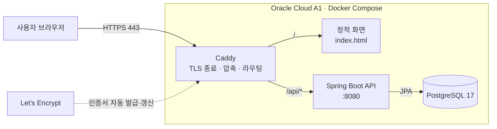
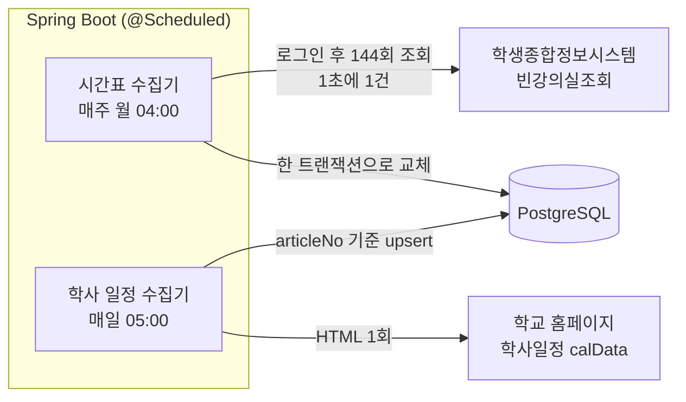

<p align="center">
  <picture>
    <source media="(prefers-color-scheme: dark)" srcset="design/logo/bingang-wordmark-dark.png">
    
  </picture>
</p>

<p align="center">영남대학교의 <b>지금 비어 있는 강의실</b>과 언제까지 비는지를 알려 주는 웹 서비스</p>

<p align="center">
  <a href="https://bingang.duckdns.org"><b>bingang.duckdns.org</b></a> ·
  <a href="docs/srs.md">요구사항 명세 (SRS)</a> ·
  <a href="docs/erd.md">ERD</a>
</p>

---

## 목차

1. [개요](#개요)
2. [주요 기능](#주요-기능)
3. [시스템 아키텍처](#시스템-아키텍처)
4. [서버 사양](#서버-사양)
5. [데이터 수집](#데이터-수집)
6. [빈 강의실 판정](#빈-강의실-판정)
7. [기술 스택](#기술-스택)
8. [프로젝트 구조](#프로젝트-구조)

## 개요

학생은 공강 시간에 빈 강의실을 찾으려고 건물을 돌며 문을 열어 본다. 빈강은 학교 시간표를 주기적으로 수집해 **건물별 빈 강의실과 남은 시간**을 보여 준다.

## 주요 기능

| 기능 | 설명 |
|---|---|
| 건물 선택 | 검색, 구역(A~G)별 목록, 즐겨찾기, 최근 본 건물, 건물별 빈 강의실 수 |
| 빈 강의실 목록 | 호수 순서·층별 정렬, 기본은 빈 곳만 표시 |
| 남은 시간 | `11:30까지 비어 있어요`, `13:00부터 비어요`, `오늘 끝까지 비어 있음` |
| 하루 타임라인 | 09–21시 막대로 수업 시간과 빈 시간 표시 |
| 시간 바꿔 보기 | 다른 요일·시각(30분 단위) 기준으로 미리 확인 |
| 보강일 반영 | 공휴일 수업 대체일에는 지정된 요일의 시간표로 판정 |
| 학사 일정 | 다음 일정, D-day, 보강일 제목 요약 |
| 기타 | 다크 모드, 로그인 없음 (즐겨찾기·테마는 브라우저에 저장) |

## 시스템 아키텍처

### 요청 흐름



- 외부에 열린 포트는 Caddy의 80·443뿐이다. API는 `127.0.0.1`에만 바인딩하고 DB는 Compose 내부 네트워크에만 둔다.
- 화면과 API를 같은 도메인에서 제공해 CORS 설정이 필요 없다.
- 화면 파일과 Caddy 설정은 Caddy 이미지에 포함해, 서버의 저장소 폴더 상태와 무관하게 동작한다.

### 데이터 수집 흐름



사용자 요청은 우리 DB만 조회하고 학교 시스템으로 넘기지 않는다. 학교 시스템에 장애가 나도 서비스는 마지막으로 수집한 데이터로 동작한다.

## 서버 사양

| 항목 | 값 |
|---|---|
| 클라우드 | Oracle Cloud Infrastructure, Always Free |
| 리전 | Japan Central (Osaka), `ap-osaka-1` |
| Shape | `VM.Standard.A1.Flex` |
| CPU | Ampere Neoverse-N1 (arm64), 2 OCPU |
| 메모리 | 12 GB |
| 디스크 | 부트 볼륨 45 GB |
| OS | Ubuntu 24.04 LTS (aarch64) |
| 런타임 | Docker 29, Docker Compose v5 |
| 도메인·인증서 | DuckDNS, Let's Encrypt (Caddy 자동 갱신) |
| 비용 | 0원 (Always Free 한도 내: A1 합계 4 OCPU / 24 GB 중 절반 사용) |

개발 환경(Apple M3)과 서버가 모두 arm64라 로컬에서 빌드한 이미지 구성이 서버에서 그대로 동작한다.

## 데이터 수집

| 데이터 | 출처 | 주기 | 방식 |
|---|---|---|---|
| 강의실 시간표 | 학생종합정보시스템 '빈강의실조회' (로그인 필요) | 매주 월 04:00, 데이터가 없으면 기동 시 1회 | 요일 6 × 시간 칸 24 = 144회 조회, 1초 간격 |
| 학사 일정 | 학교 홈페이지 학사일정 페이지 | 매일 05:00, 데이터가 없으면 기동 시 1회 | HTML에 포함된 `calData` JSON 추출 |

**시간표 복원.** 학교 시스템은 "그 시간 칸에 비어 있는 강의실"만 알려 준다. 칸마다 조회한 결과를 전체 강의실에서 빼면 강의실별 사용 시간이 되고, 이어지는 칸은 하나의 수업으로 합쳐 저장한다.

**안전장치.**

- 조회가 하나라도 실패하면(타임아웃, 세션 만료) 저장하지 않고 기존 데이터를 유지한다.
- 모든 칸의 결과가 같으면 시간 조건이 무시된 것으로 보고 저장하지 않는다.
- 일주일 내내 수업이 없는 강의실과, 그런 강의실만 있는 건물은 목록에서 뺀다.
- 칸별 빈 강의실 수를 요일마다 로그로 남겨 이상을 바로 확인할 수 있다.
- 학교 계정은 서버 환경 변수로만 받고 저장소·로그에 남기지 않는다.

## 빈 강의실 판정

- 시각 `t`에 `start ≤ t < end`인 수업이 있으면 사용 중이다. 수업이 끝나는 정각은 비어 있다.
- 시각과 요일은 서버 시간대와 무관하게 항상 `Asia/Seoul` 기준이다.
- 보강일에는 그날 요일 대신 학사 일정에 지정된 요일의 시간표를 쓴다.
- 맞닿거나 겹치는 수업(연강)은 하나로 이어서 본다. 사용 중이면 이어진 수업이 모두 끝나는 시각부터 빈다.

자세한 규칙과 응답 예시는 [요구사항 명세 (SRS)](docs/srs.md)에 있다.

## 기술 스택

| 영역 | 기술 |
|---|---|
| Backend | Java 21, Spring Boot 4, Spring Data JPA, Flyway, RestClient |
| Database | PostgreSQL 17 |
| Frontend | HTML · CSS · JavaScript (프레임워크 없음), Pretendard |
| Web server | Caddy 2 |
| Test | JUnit 5, AssertJ, Mockito, Testcontainers, MockMvc |
| Infra | Oracle Cloud A1 (arm64), Docker Compose, DuckDNS |
| CI/CD | GitHub Actions |

## 프로젝트 구조

```
bingang/
├── api/                          Spring Boot
│   └── src/main/java/com/bingang/
│       ├── building/             entity · repository · service
│       ├── room/                 entity · repository · service(판정) · controller · dto · collect(시간표 수집)
│       ├── calendar/             entity · repository · service · controller · dto · collect(학사 일정 수집)
│       └── common/               config(Clock, 스케줄링) · exception(공통 오류 응답) · jpa
├── web/                          화면(index.html), Caddy 이미지 Dockerfile
├── docs/                         요구사항 명세(srs.md), ERD(erd.md)
├── design/logo/                  로고
├── .github/                      이슈·PR 템플릿, 테스트·배포 워크플로
├── Caddyfile
└── compose.yaml
```

도메인(`building`, `room`, `calendar`)별로 패키지를 나누고, 그 안을 계층별로 나눈다. 의존은 `room → building`, `room → calendar` 방향으로만 흐른다.
