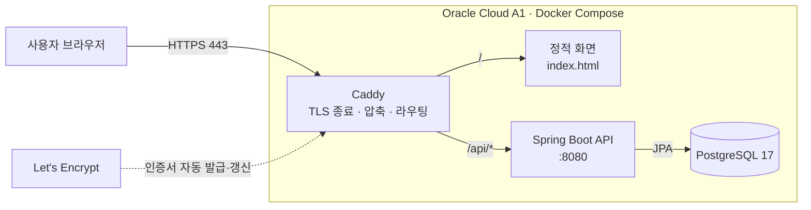
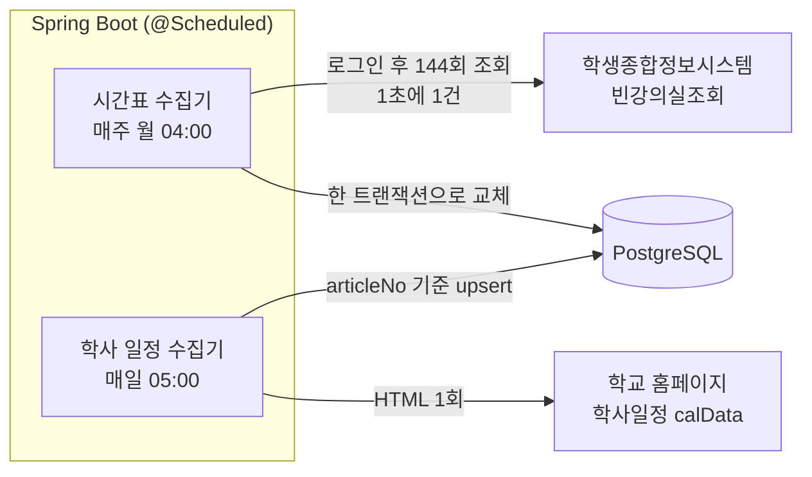
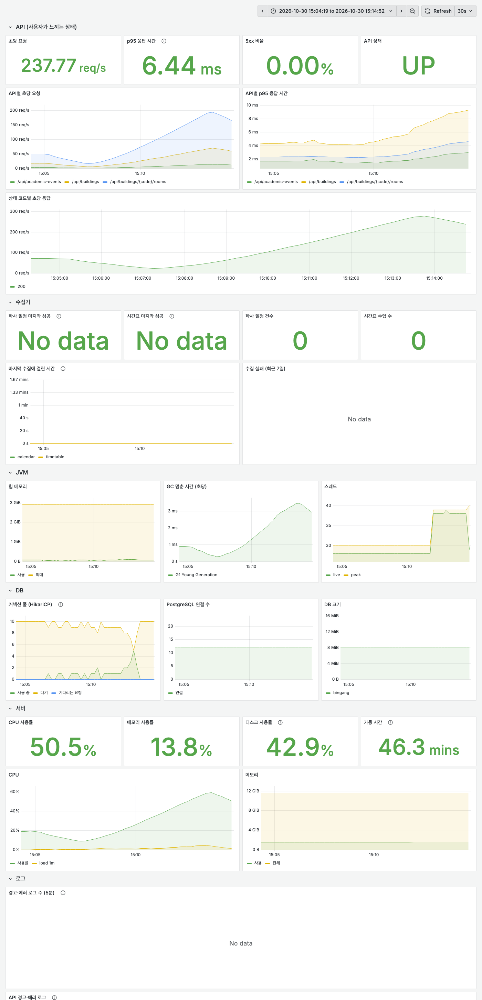
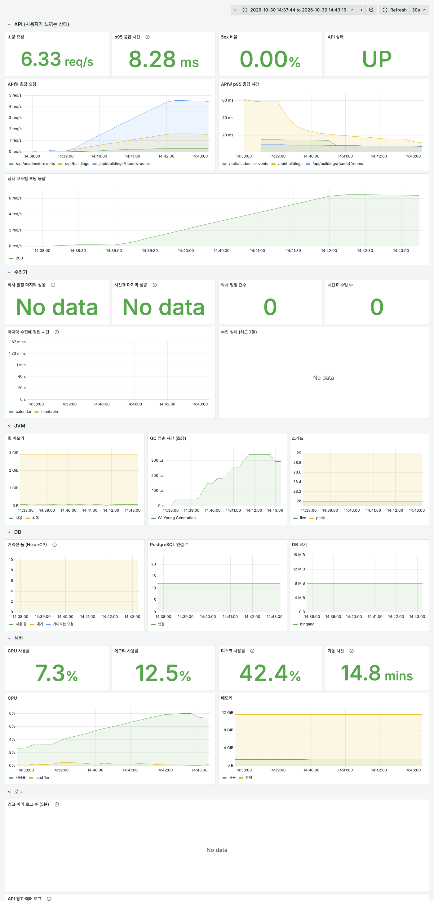
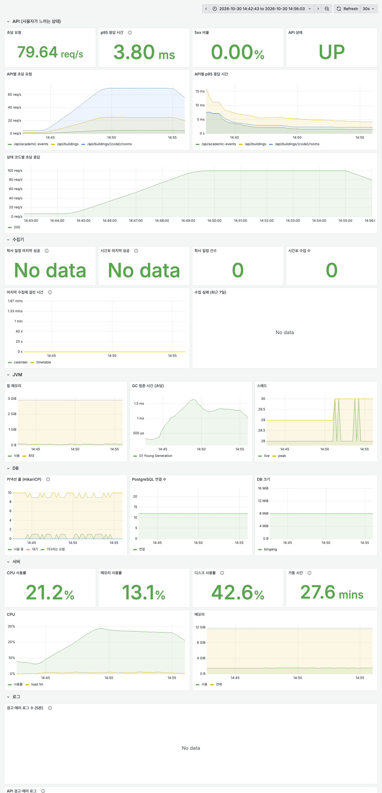
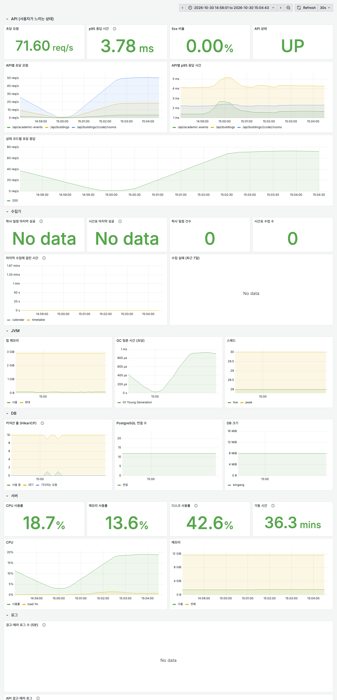

<p align="center">
  <picture>
    <source media="(prefers-color-scheme: dark)" srcset="design/logo/bingang-wordmark-dark.png">
    
  </picture>
</p>

<p align="center">영남대학교의 <b>지금 비어 있는 강의실</b>과 언제까지 비는지를 알려 주는 웹 서비스</p>

<p align="center">
  <a href="https://bingang.duckdns.org"><b>bingang.duckdns.org</b></a> ·
  <a href="docs/srs.md">요구사항 명세 (SRS)</a> ·
  <a href="docs/erd.md">ERD</a>
</p>

---

## 목차

1. [개요](#개요)
2. [주요 기능](#주요-기능)
3. [시스템 아키텍처](#시스템-아키텍처)
4. [서버 사양](#서버-사양)
5. [데이터 수집](#데이터-수집)
6. [빈 강의실 판정](#빈-강의실-판정)
7. [기술 스택](#기술-스택)
8. [프로젝트 구조](#프로젝트-구조)
9. [부하 테스트](#부하-테스트)

## 개요

학생은 공강 시간에 빈 강의실을 찾으려고 건물을 돌며 문을 열어 본다. 빈강은 학교 시간표를 주기적으로 수집해 **건물별 빈 강의실과 남은 시간**을 보여 준다.

## 주요 기능

| 기능 | 설명 |
|---|---|
| 건물 선택 | 검색, 구역(A~G)별 목록, 즐겨찾기, 최근 본 건물, 건물별 빈 강의실 수 |
| 빈 강의실 목록 | 호수 순서·층별 정렬, 기본은 빈 곳만 표시 |
| 남은 시간 | `11:30까지 비어 있어요`, `13:00부터 비어요`, `오늘 끝까지 비어 있음` |
| 하루 타임라인 | 09–21시 막대로 수업 시간과 빈 시간 표시 |
| 시간 바꿔 보기 | 다른 요일·시각(30분 단위) 기준으로 미리 확인 |
| 보강일 반영 | 공휴일 수업 대체일에는 지정된 요일의 시간표로 판정 |
| 학사 일정 | 다음 일정, D-day, 보강일 제목 요약 |
| 기타 | 다크 모드, 로그인 없음 (즐겨찾기·테마는 브라우저에 저장) |

## 시스템 아키텍처

### 요청 흐름



- 외부에 열린 포트는 Caddy의 80·443뿐이다. API는 `127.0.0.1`에만 바인딩하고 DB는 Compose 내부 네트워크에만 둔다.
- 화면과 API를 같은 도메인에서 제공해 CORS 설정이 필요 없다.
- 화면 파일과 Caddy 설정은 Caddy 이미지에 포함해, 서버의 저장소 폴더 상태와 무관하게 동작한다.

### 데이터 수집 흐름



사용자 요청은 우리 DB만 조회하고 학교 시스템으로 넘기지 않는다. 학교 시스템에 장애가 나도 서비스는 마지막으로 수집한 데이터로 동작한다.

## 서버 사양

| 항목 | 값 |
|---|---|
| 클라우드 | Oracle Cloud Infrastructure, Always Free |
| 리전 | Japan Central (Osaka), `ap-osaka-1` |
| Shape | `VM.Standard.A1.Flex` |
| CPU | Ampere Neoverse-N1 (arm64), 2 OCPU |
| 메모리 | 12 GB |
| 디스크 | 부트 볼륨 45 GB |
| OS | Ubuntu 24.04 LTS (aarch64) |
| 런타임 | Docker 29, Docker Compose v5 |
| 도메인·인증서 | DuckDNS, Let's Encrypt (Caddy 자동 갱신) |
| 비용 | 0원 (Always Free 한도 내: A1 합계 4 OCPU / 24 GB 중 절반 사용) |

개발 환경(Apple M3)과 서버가 모두 arm64라 로컬에서 빌드한 이미지 구성이 서버에서 그대로 동작한다.

## 데이터 수집

| 데이터 | 출처 | 주기 | 방식 |
|---|---|---|---|
| 강의실 시간표 | 학생종합정보시스템 '빈강의실조회' (로그인 필요) | 매주 월 04:00, 데이터가 없으면 기동 시 1회 | 요일 6 × 시간 칸 24 = 144회 조회, 1초 간격 |
| 학사 일정 | 학교 홈페이지 학사일정 페이지 | 매일 05:00, 데이터가 없으면 기동 시 1회 | HTML에 포함된 `calData` JSON 추출 |

**시간표 복원.** 학교 시스템은 "그 시간 칸에 비어 있는 강의실"만 알려 준다. 칸마다 조회한 결과를 전체 강의실에서 빼면 강의실별 사용 시간이 되고, 이어지는 칸은 하나의 수업으로 합쳐 저장한다.

**안전장치.**

- 조회가 하나라도 실패하면(타임아웃, 세션 만료) 저장하지 않고 기존 데이터를 유지한다.
- 모든 칸의 결과가 같으면 시간 조건이 무시된 것으로 보고 저장하지 않는다.
- 일주일 내내 수업이 없는 강의실과, 그런 강의실만 있는 건물은 목록에서 뺀다.
- 칸별 빈 강의실 수를 요일마다 로그로 남겨 이상을 바로 확인할 수 있다.
- 학교 계정은 서버 환경 변수로만 받고 저장소·로그에 남기지 않는다.

## 빈 강의실 판정

- 시각 `t`에 `start ≤ t < end`인 수업이 있으면 사용 중이다. 수업이 끝나는 정각은 비어 있다.
- 시각과 요일은 서버 시간대와 무관하게 항상 `Asia/Seoul` 기준이다.
- 보강일에는 그날 요일 대신 학사 일정에 지정된 요일의 시간표를 쓴다.
- 맞닿거나 겹치는 수업(연강)은 하나로 이어서 본다. 사용 중이면 이어진 수업이 모두 끝나는 시각부터 빈다.

자세한 규칙과 응답 예시는 [요구사항 명세 (SRS)](docs/srs.md)에 있다.

## 기술 스택

| 영역 | 기술 |
|---|---|
| Backend | Java 21, Spring Boot 4, Spring Data JPA, Flyway, RestClient |
| Database | PostgreSQL 17 |
| Frontend | HTML · CSS · JavaScript (프레임워크 없음), Pretendard |
| Web server | Caddy 2 |
| Test | JUnit 5, AssertJ, Mockito, Testcontainers, MockMvc |
| Infra | Oracle Cloud A1 (arm64), Docker Compose, DuckDNS |
| CI/CD | GitHub Actions |

## 프로젝트 구조

```
bingang/
├── api/                          Spring Boot
│   └── src/main/java/com/bingang/
│       ├── building/             entity · repository · service
│       ├── room/                 entity · repository · service(판정) · controller · dto · collect(시간표 수집)
│       ├── calendar/             entity · repository · service · controller · dto · collect(학사 일정 수집)
│       └── common/               config(Clock, 스케줄링) · exception(공통 오류 응답) · jpa
├── web/                          화면(index.html), Caddy 이미지 Dockerfile
├── docs/                         요구사항 명세(srs.md), ERD(erd.md)
├── design/logo/                  로고
├── .github/                      이슈·PR 템플릿, 테스트·배포 워크플로
├── Caddyfile
└── compose.yaml
```

도메인(`building`, `room`, `calendar`)별로 패키지를 나누고, 그 안을 계층별로 나눈다. 의존은 `room → building`, `room → calendar` 방향으로만 흐른다.

## 부하 테스트

사용자 공개 전, 예상 이용 패턴을 가정하고 k6로 운영 서버의 처리 성능을 확인했다. 아래 이용 규모와 요청 비율은 **실제 방문 통계가 아닌 테스트 설계용 가정**이다. 여기서 TPS는 초당 API 요청 수(req/s)를 뜻한다.

### 왜 200 TPS를 목표로 했는가

재학생 약 3만 명을 기준으로 10%인 하루 3,000명이 이용하고, 한 번 이용할 때 API를 약 4회 호출한다고 가정했다. 일평균보다 공강·쉬는 시간에 요청이 집중되는 상황을 기준으로 계산했다.

| 상황 | 이용 가정 | 예상 요청량 |
|---|---|---|
| 평소 피크 | 5분 동안 750명 × 요청 4회 | 3,000 ÷ 300초 = **10 TPS** |
| 순간 집중 | 1분 동안 1,500명 × 요청 4회 | 6,000 ÷ 60초 = **100 TPS** |
| 검증 목표 | 순간 집중 요청량의 2배 | **200 TPS** |

목표 기준은 **서버 p95 응답 시간 200ms 이하, 오류율 1% 미만**으로 정했다.

### 어떻게 실험했는가

- **환경:** OCI A1 2 OCPU / 메모리 12GB, GitHub Actions에서 k6 실행 (2026-10-30)
- **요청 비율:** 현재 강의실 조회 55%, 건물 목록 25%, 시간을 바꾼 강의실 조회 15%, 학사 일정 5%
- **부하 방식:** arrival-rate로 요청 발생률을 설정하고, 일정 부하·순간 증가·단계적 증가 시나리오 실행
- **관측:** k6의 요청 결과와 Prometheus·Grafana의 서버 응답 시간, CPU, JVM, DB 커넥션을 함께 확인
- **외부 시스템 분리:** 사용자 API는 내부 DB만 조회하므로 부하 테스트 요청이 학교 시스템으로 전달되지 않음

건물 코드는 API에서 가져온 목록 중 무작위로 선택하고, 시간 변경 조회는 평일의 임의 시각으로 구성했다. 정적 화면 렌더링이나 실제 브라우저 조작을 측정한 테스트는 아니다. k6에서는 별도로 네트워크 구간을 포함한 p95 500ms 미만, 오류율 1% 미만을 통과 기준으로 사용했다.

### 측정 결과 (2026-10-30)

smoke로 시나리오 동작을 확인한 뒤 baseline → load → spike → stress를 실행했다.

| 시나리오 | 설정 부하 | 서버 p95 최댓값¹ | 오류율 | CPU 최대 |
|---|---|---|---|---|
| baseline | 10 TPS, 3분 | 42.7ms | 0% | 13% |
| load | 1분 동안 10 → 100 TPS, 이후 100 TPS로 10분 유지 | 7.0ms | 0% | 33% |
| spike | 10초 동안 10 → 150 TPS, 이후 150 TPS로 2분 유지 | 4.2ms | 0% | 미기록 |
| stress | 50 → 400 TPS까지 1분 단위로 목표를 50씩 증가 | 8.1ms | 0% | 75% |

¹ 1분 구간으로 계산한 서버 측 p95 중 관측 최댓값이다. 개별 요청의 최대 응답 시간이 아니다. k6에서 측정한 네트워크 구간 포함 p95는 시나리오별 약 117~168ms로, 서버 측 지표와 구분했다.

| 시나리오 | 기록된 총 요청 수 |
|---|---|
| baseline | 1,802 |
| load | 63,300 |
| spike | 20,801 |
| stress | 97,489 |

### 결과 해석과 검증 범위

설정 부하를 400 TPS까지 높인 stress 테스트에서도 기록된 오류율은 0%였다. 이때 CPU 사용률은 최대 75%였고, DB 커넥션 대기는 0, 사용 중인 커넥션은 최대 5/10개였다. 테스트 범위에서는 DB 연결 고갈보다 CPU 사용률 증가가 두드러졌다.

추가로 stress 구간의 힙 사용량은 최대 117MB, GC 시간은 최대 약 5ms/s로 기록됐다. 이 결과를 근거로 즉시 캐시나 서버 증설을 적용하기보다, 공개 후 실제 요청 패턴을 관측하며 개선 여부를 판단하기로 했다. 시간표 캐시는 요청당 DB 조회와 계산량을 줄일 수 있는 후속 개선 후보이며, 이번 테스트에서 적용하거나 효과를 검증한 것은 아니다.

**200 TPS 목표는 stress의 증가 구간에서 확인했으며, 200·400 TPS를 장시간 유지한 결과는 아니다.** 실제 포화 지점과 장시간 안정성은 아직 검증하지 않았다. 따라서 400 TPS를 서비스의 최대 처리량으로 단정하거나, CPU 추세만으로 한계를 확정하지 않는다.

### Grafana 측정 화면

캡처는 각 테스트 구간과 앞뒤 약 1분을 포함한다. 그래프의 `rate(...[5m])`는 5분 범위로 계산되므로 짧은 부하 변화가 완만하게 표시된다. 위 표의 서버 p95와 CPU 최댓값은 별도로 기록한 1분 기준 수치를 사용했다.

#### 단계적 부하 증가: 50 → 400 TPS

요청 발생률을 높이면서 API 응답 시간과 오류율, CPU·JVM·DB 지표의 변화를 함께 확인했다. 마지막 1분은 350에서 400 TPS로 증가하는 구간으로, 400 TPS를 유지한 별도 구간은 없다.



<details>
<summary>기준 부하·지속 부하·순간 부하 캡처 보기</summary>

#### 기준 부하: 10 TPS, 3분

낮은 요청량에서 비교 기준을 확보했다. 서버 p95 관측 최댓값은 42.7ms, 오류율은 0%였다. 이 값이 고부하 테스트보다 높다는 사실만으로 부하가 늘면 빨라진다고 해석하지 않는다. 실행 순서와 초기 요청 영향 등을 분리한 반복 실험은 수행하지 않았다.



#### 지속 부하: 100 TPS, 10분 유지

가정한 순간 피크를 10분 동안 유지했다. 서버 p95 관측 최댓값 7.0ms, 오류율 0%, CPU 최대 33%를 기록했다.



#### 순간 부하: 10초 동안 10 → 150 TPS

요청 발생률을 빠르게 높이고 150 TPS를 2분 동안 유지했다. 서버 p95 관측 최댓값은 4.2ms, 오류율은 0%였다.



</details>

[테스트 시나리오](loadtest/scenario.js) · [상세 결과 및 Grafana 캡처](loadtest/results/2026-10-30/README.md) · [측정 기록 #35](https://github.com/eastminnn/bingang/issues/35)
