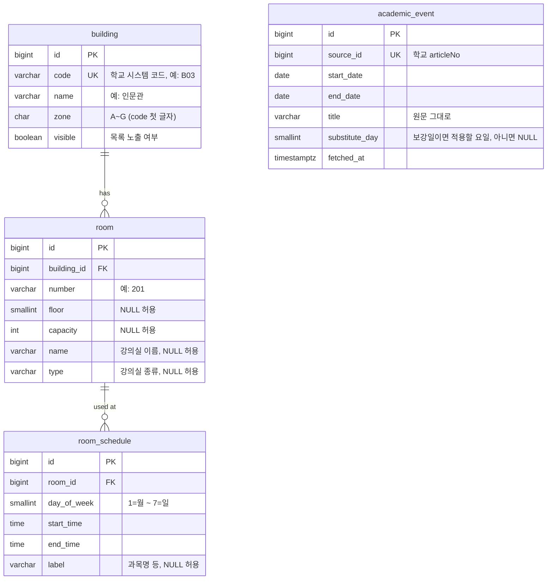

# 빈강 ERD

> 최종 수정 2026-10-28

## 제약

- `room`: `UNIQUE (building_id, number)`
- `room_schedule`: `CHECK (start_time < end_time)`, `INDEX (room_id, day_of_week)`
- `academic_event`: `CHECK (start_date <= end_date)`, `INDEX (start_date)`

## 메모

- `room_schedule`은 "강의실이 언제 사용 중인가"만 담는다. 과목 정보는 `label` 하나로 충분하다.
- 시간은 교시가 아니라 `time`으로 저장한다.
- 학기 구분은 없다. 학기가 바뀌면 시간표를 교체한다.
- `academic_event.substitute_day`는 수집할 때 `공휴일수업대체지정일(… (목) …)`을 해석해서 채운다. 판정할 때는 그 날짜에 값이 있으면 그 요일의 시간표를 쓴다.
- `building.visible`: 시간표가 있어도 목록에서 뺄 건물(예: 중앙도서관)을 숨긴다.
- `building`·`room`은 시간표 수집기가 빈강의실조회 응답(`ltDong`, `ltDongNm`, `ltRoomNo`, `admtRcnt`, `ltRoomNm`, `ltRoomType1`)으로 채운다. 건물 코드는 캠퍼스 지도가 아니라 학교 시스템 코드를 쓴다.
- 스키마는 Flyway로 관리한다 (`V1__init.sql`, `V2__room_details.sql`).
