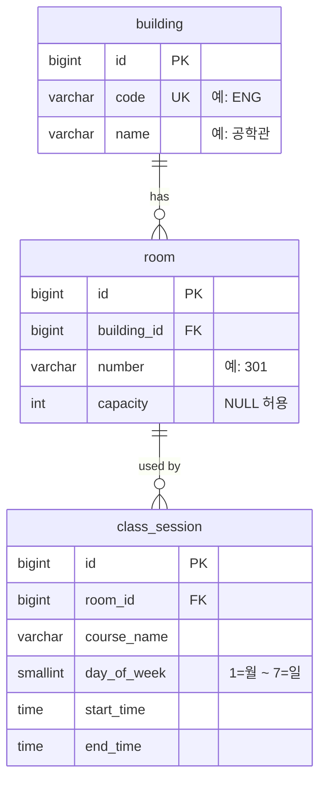

# 빈강 ERD

> 최종 수정 2026-10-28

## 제약

- `room`: `UNIQUE (building_id, number)`
- `class_session`: `CHECK (start_time < end_time)`, `INDEX (room_id, day_of_week)`

## 메모

- 시간은 교시가 아니라 `time`으로 저장한다 (학교마다 교시 길이가 다름).
- 학기 구분 없음. 현재 학기 데이터만 둔다고 가정한다.
- 스키마는 Flyway로 관리한다. 가짜 데이터 시드는 `local` 프로필에서만 적용한다.
